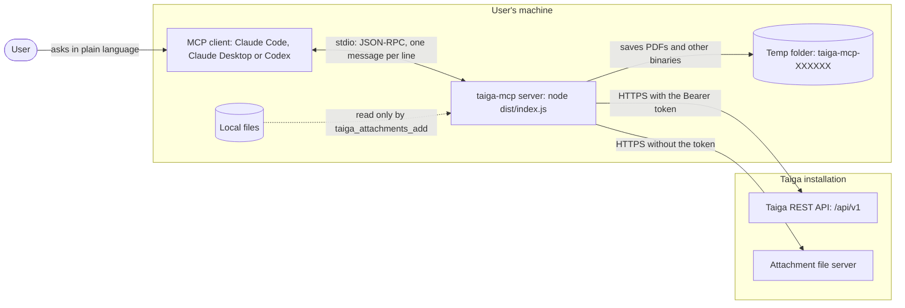
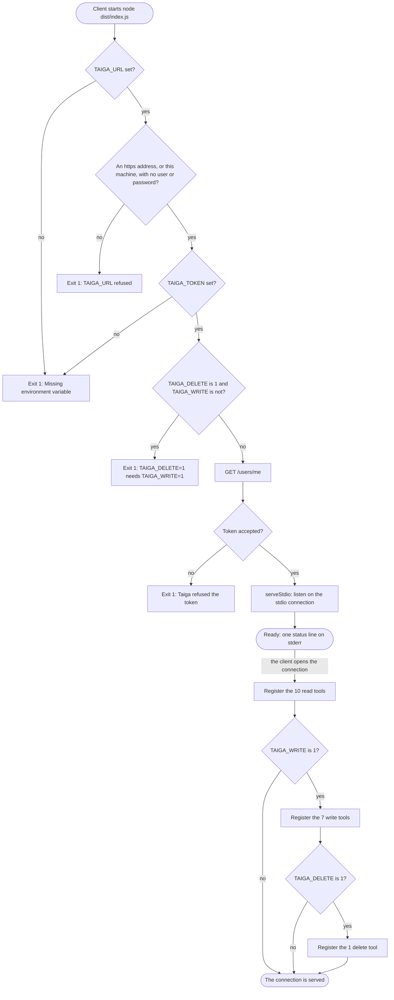
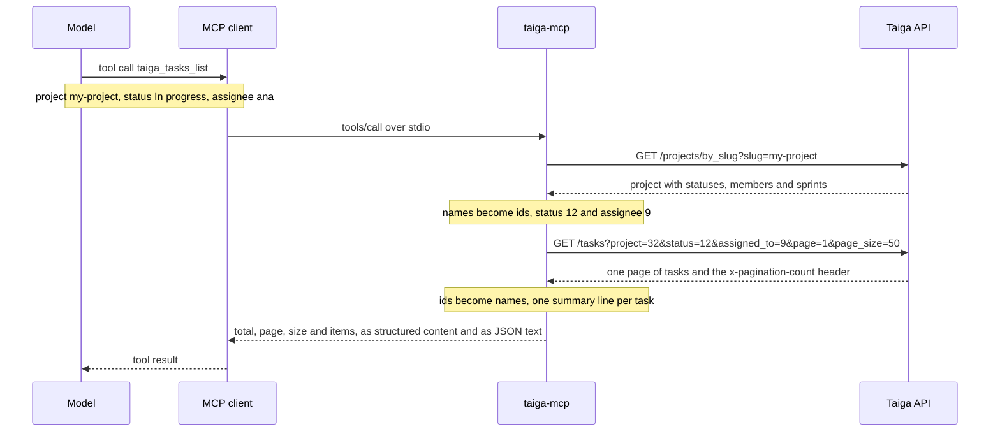
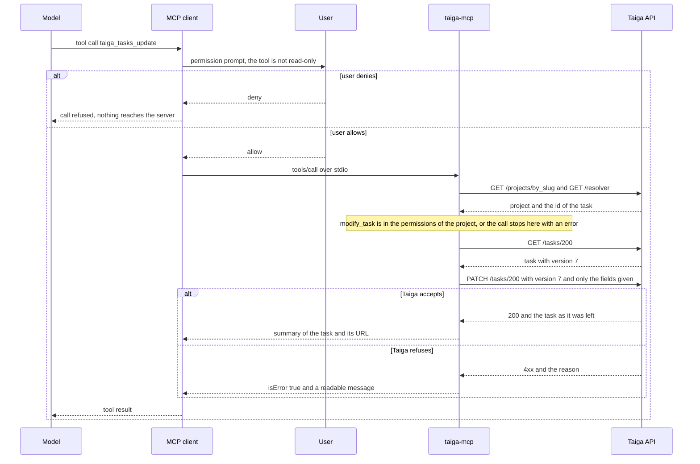
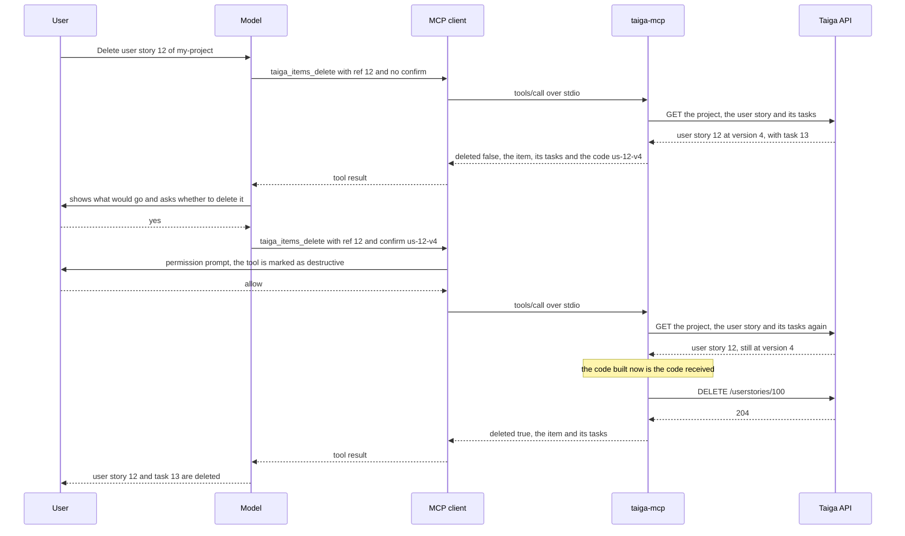

# Architecture

How the server is built and what happens between a request in plain language and the Taiga API. For the list of
tools see [TOOLS.md](TOOLS.md); for the threat model see [SECURITY.md](../SECURITY.md).

## Components

The diagram shows the processes involved in a session and what travels between them.



<details>
<summary>The same diagram in Mermaid, with every label</summary>



</details>

| Component | What it is | Notes |
| --- | --- | --- |
| MCP client | Claude Code, Claude Desktop, Codex or any client that starts a stdio server | Starts the server as a child process and decides when to ask the user for permission |
| `taiga-mcp` | One Node process, `node dist/index.js` | Holds the token in memory. Keeps no cache of Taiga. Between calls it remembers only the number of calls of the current minute and the folder where it saves files |
| Taiga REST API | `<TAIGA_URL>/api/v1` | Every request carries `Authorization: Bearer <token>` and has a time limit of 120 seconds |
| Attachment file server | The address Taiga lists for each attachment | Read without the session token: where files are protected, the address carries its own short-lived key |
| Temp folder | One folder per run of the server, `taiga-mcp-` and six random characters, inside the temp folder of the system | Receives the attachments that are neither a text nor an image of up to 3.5 MB. Made by `mkdtemp` on the first file saved, so on Linux and macOS only the user of the process opens it. Made again if it is deleted while the server runs |
| Local files | Any file the user can read | Read only by `taiga_attachments_add`, and only the path given in the call. A path that looks like a credential is refused |

The whole server is one file, [`src/index.ts`](../src/index.ts): a small HTTP client for Taiga, the conversion of
names into ids, the permission check, the tools and the start sequence.

## Start and the two gates

The diagram shows what the server does between being started and being ready, and where the decisions to register
the write tools and the delete tool are taken. The drawing groups the start checks into one step and the Mermaid
version shows each of them.



<details>
<summary>The same diagram in Mermaid, with every label</summary>



</details>

- A missing variable, a refused address, `TAIGA_DELETE=1` without `TAIGA_WRITE=1`, a Taiga that does not answer or
  a refused token ends the process with exit code 1 and one line on stderr, before any tool exists. The client
  shows that line in its server log.
- `TAIGA_URL` must start with `https://`: over plain `http://` the token would travel in clear text. Only this
  machine (`localhost`, `127.0.0.1`, `[::1]`) may be reached over `http://`. An address with a user or a password
  in it is refused too. The address is checked before any request is made.
- `TAIGA_WRITE` and `TAIGA_DELETE` are read once, at start, and only the exact value `1` counts. `TAIGA_WRITE=1`
  registers the 7 write tools. `TAIGA_DELETE=1` on top of it registers `taiga_items_delete`; alone, it stops the
  server with `TAIGA_DELETE=1 needs TAIGA_WRITE=1: deleting is a kind of writing.`
- The tools behind a closed gate are not hidden or disabled: they do not exist, so `tools/list` never shows them
  and a call to one is a protocol error.
- The tools are registered when the client opens the connection. `serveStdio` takes a function that builds the
  server, and calls it when the opening message of the client shows which revision of the protocol it speaks. The
  set of tools is the same for the whole run, because the two variables were read at start. The drawing shows the
  registration as a step of the start.
- The server writes one status line to stderr when it is ready, for example
  `taiga-mcp: https://taiga.example.com as ana (read-only)`. With writing on the line ends with
  `(writes user stories, tasks, issues and attachments)`, and with deleting on with
  `(writes user stories, tasks, issues and attachments, and deletes them)`. stdout carries only protocol messages.
- The server leaves by itself when the client closes its input.

## A read call

The diagram shows one read call from the model to Taiga and back, with the two conversions the server makes:
names into ids on the way in, ids into names on the way out.



<details>
<summary>The same diagram in Mermaid, with every label</summary>



</details>

- The model never needs an id. It writes `"In progress"`, a sprint name or a username; the server reads the
  project on every call and looks the name up. There is no cache, which costs one `GET` and never serves a stale
  name.
- A name that does not exist is answered with the valid ones, for example
  `Unknown task status "Inexistente". Valid: A fazer, Em andamento`, so the model corrects itself in one step.
- Lists return one summary line per item, without the description, and the total Taiga counted. The default page
  has 50 items and the largest has 200.
- The answer goes out twice, as structured content and as the same JSON in a text block: see
  [Structured answers](#structured-answers).

## A write call

The diagram shows a write call, with the places where it can stop: the permission prompt of the client, the
permission check of the server and a refusal from Taiga. The drawing shows the first and the last.



<details>
<summary>The same diagram in Mermaid, with every label</summary>



</details>

- The server does not ask for confirmation by itself. It declares each write tool as not read-only
  (`readOnlyHint: false`), and the three tools that edit and the one that deletes as destructive
  (`destructiveHint: true`), and the client decides to ask. Whether and when a client asks is a property of the
  client: see the guide of yours in [`docs/clients/`](clients/).
- Before anything is sent, the server looks for the permission the write needs in the list Taiga gives for the
  project: see [The permission check](#the-permission-check).
- Taiga refuses an edit that does not say which version of the item it was made on. The server reads the version
  immediately before the `PATCH` and sends it along.
- Only the fields given in the call are sent. `"none"` empties a field (assignee, due date, block), and
  `"backlog"` takes a user story or an issue out of every sprint.
- Every write goes through one function, `TaigaClient.send`. Without `TAIGA_DELETE=1` the only methods it uses are
  `POST` and `PATCH`, and nothing is deleted. With it, `DELETE` is sent by one tool only, `taiga_items_delete`, and
  only on its second call.

## What 0.3.0 added to the design

Three things are new in how a call is handled: a permission check before a write, a deletion in two calls, and
answers that are data as well as text.

### The permission check

- Taiga gives, with each project, the list of what the current user may do in it. The server reads the project on
  every call anyway, so the check costs no request. `taiga_projects_get` shows the list as `myPermissions`.
- Before a write, the server looks for the permission the write needs: `add_`, `modify_` or `delete_` followed by
  `us` (user story), `task` or `issue`. When it is missing nothing is sent, and the tool error says what that role
  may do in its place. Only the alternatives the role has the permission for are listed, and the last one is
  always to ask a project admin. The table of alternatives is in [TOOLS.md](TOOLS.md#permissions).
- The error ends by telling the model not to work around the refusal on its own: it tells the user what was
  refused, offers the alternatives and waits for the choice. The instructions of the server say the same, and so
  does the error for a `403` that comes from Taiga.
- An edit that is only a `comment` needs only the comment permission, as in Taiga.
- A project that gives no list is not judged by the server: the write is sent and Taiga decides. Taiga also
  decides alone for `taiga_attachments_add`, which the server does not check.
- The check is a help to the model and to the user. The permissions themselves are enforced by Taiga.

### Deleting in two calls

The diagram shows the two calls of a deletion, with the question to the user between them.



- The first call, without `confirm`, deletes nothing. It answers with `deleted: false`, the item, for a user story
  the tasks that go with it (`tasksDeletedWithIt`), a code in `confirm` and, in `next`, what the model must do
  before calling again: show this to the user and ask.
- The code is the kind of the item, its number and the version Taiga had of it when it was shown, for example
  `us-12-v4`. The server keeps nothing between the two calls: on the second one it reads the item again, builds the
  code again and compares. An item that changed since then has another code, so nothing is deleted and the item is
  shown again.
- The second call is made by the model. The code shows that the item was looked at, not that a person said yes.
  The person in the loop is the permission prompt of the client, which the annotation `destructiveHint: true`
  feeds. Whether and when a client asks is a property of the client. The diagram shows the prompt before the call
  that deletes; the first call is a call of the same tool, so a client may ask before it as well.
- The permission to delete is checked on both calls, before the item is shown.
- Taiga keeps no trash. A user story goes with its tasks, and every item with its comments and attachments.

### Structured answers

- Every tool that answers data declares an `outputSchema` and answers with `structuredContent` in that shape, plus
  the same JSON in one `text` block, for the clients that read only text. One function, `run`, makes both from the
  same object.
- `taiga_attachments_get` is the exception. It answers with content (an image, a text, or the path of a saved
  file) and declares no `outputSchema`.
- The schema of an answer is an object, so the two tools that used to answer a bare array now answer an object
  with the list inside: `taiga_projects_list` gives `{ "projects": [...] }` and `taiga_sprints_list` gives
  `{ "sprints": [...] }`.
- In the schemas, a value Taiga may leave out may be missing or null, so that an answer is never refused for it.
- An error does not follow the schema: it is a result with `isError: true` and one readable sentence.

## Taiga endpoints used

| Method and path | Used by |
| --- | --- |
| `GET /users/me` | start check, `taiga_me`, `taiga_projects_list` |
| `GET /projects`, `GET /projects/by_slug`, `GET /projects/<id>` | `taiga_projects_list`, and every tool that takes `project` |
| `GET /milestones` | `taiga_sprints_list` |
| `GET /userstories`, `GET /tasks`, `GET /issues` | the three list tools, and the task list of a user story in `taiga_items_get` and `taiga_items_delete` |
| `GET /resolver` | finding an item by its number |
| `GET /userstories/<id>`, `GET /tasks/<id>`, `GET /issues/<id>` | `taiga_items_get`, the version read of the three tools that edit, and `taiga_items_delete` |
| `GET /userstories/attachments`, `GET /tasks/attachments`, `GET /issues/attachments` | `taiga_items_get`, `taiga_attachments_get` |
| `GET /history/userstory/<id>`, `GET /history/task/<id>`, `GET /history/issue/<id>` | `taiga_items_get` with `include` |
| `GET /search` | `taiga_search` |
| `POST /userstories`, `PATCH /userstories/<id>` | `taiga_userstories_create`, `taiga_userstories_update` |
| `POST /tasks`, `PATCH /tasks/<id>` | `taiga_tasks_create`, `taiga_tasks_update` |
| `POST /issues`, `PATCH /issues/<id>` | `taiga_issues_create`, `taiga_issues_update` |
| `POST /userstories/attachments`, `POST /tasks/attachments`, `POST /issues/attachments` | `taiga_attachments_add` |
| `DELETE /userstories/<id>`, `DELETE /tasks/<id>`, `DELETE /issues/<id>` | `taiga_items_delete`, on its second call |

## Protocol support

- Transport: stdio only. Each person runs their own process with their own token; there is no shared HTTP mode.
- SDK: version 2 of the MCP TypeScript SDK, package `@modelcontextprotocol/server` 2.x (2.3.1 in the lock file).
  It replaces `@modelcontextprotocol/sdk` 1.x and needs Node 20 or newer.
- Both protocol eras on one connection. The server is started with `serveStdio`, and the opening message of the
  client decides how the connection is served. A client of revision `2026-07-28` sends its requests without a
  handshake and can ask `server/discover` what the server supports. A client of an older revision starts with the
  `initialize` handshake. Both get the same tools, built by the same function.
- Capabilities declared: `tools`. The server has no resources, no prompts and uses no sampling, roots or protocol
  logging.
- A call to a tool that does not exist is a protocol error, `-32602`. An argument of the wrong type comes back as
  a tool error, and so does every failure inside a tool.

## Design decisions

- **Session token, not a password.** The server uses the token Taiga gives the browser after login, so it also
  works where people enter through an identity provider and have no password in Taiga.
- **Read-only by default, writing behind a gate, deleting behind a second one.** Without `TAIGA_WRITE=1` every
  request to the API is a `GET`. Without `TAIGA_DELETE=1` on top of it no `DELETE` is sent. A configuration made
  for reading stays read-only after an update of the server, and one made for writing does not start deleting.
- **Confirmation by the client.** The write tools describe themselves through annotations and the client asks.
  Deleting adds a step of its own, a first call that only shows, but the second call is still made by the model.
- **A refusal comes with the way out.** When the role of the user lacks a permission, the error lists what that
  role may do instead and leaves the choice to the user.
- **A task is always on a board.** The API accepts a task with no user story and no sprint, which no screen shows.
  The server refuses that call before sending anything.
- **A file is sent by its path, not by its content.** The server runs on the machine of the user and reads the
  file from disk. Passing the content through the model would spend context and does not work for binaries.
- **An attachment is read without the session token.** The server downloads only addresses the API listed for
  that item and does not send the token to them, so the token does not leave the Taiga API if the files live on
  another host.
- **An attachment arrives according to its kind.** Images and texts go in the answer, which any client
  understands. A PDF or a spreadsheet would need a library to extract text, so it becomes a local file.
- **Short answers.** Lists carry one line per item and the total. A real project has hundreds of items.
- **Answers as data and as text.** A client that reads structured content gets an object in a declared shape. A
  client that reads only text gets the same JSON.
- **An error is a tool result.** A wrong name or a refusal from the API comes back as readable text.
- **One source file.** Eighteen tools over a small client: splitting it would only spread what is read at once.

## Source layout

```
taiga-mcp/
├── src/index.ts        API client, name conversion, permission check, tools and start sequence
├── test/smoke.mjs      scenarios against a simulated Taiga
├── test/coverage.mjs   runs the scenarios and measures how much of the built server they run
├── test/live.mjs       the same server against a real Taiga, run by hand
├── docs/               this documentation
├── dist/               build output (not in git)
├── package.json
└── tsconfig.json
```
