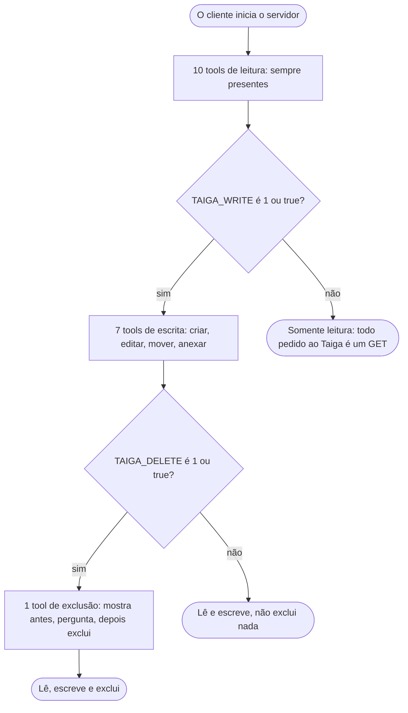
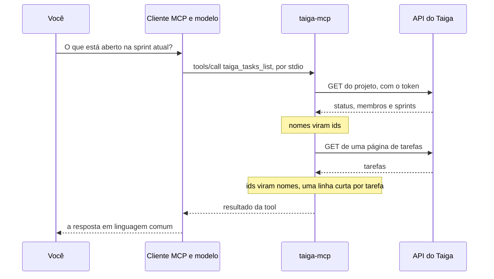

# Servidor MCP do Taiga

[](https://github.com/CamposCodes/taiga-r2da-mcp/actions/workflows/ci.yml)
[](LICENSE)
[](package.json)

[English](readme.md)

Servidor do [Model Context Protocol](https://modelcontextprotocol.io) que liga ferramentas de IA a uma instalação
do [Taiga](https://taiga.io) 6. Com ele, o Claude Code, o Claude Desktop, o Codex ou qualquer cliente MCP lê
projetos, sprints, histórias de usuário, tarefas, problemas e os anexos deles em nome de quem fez o login, e
responde perguntas como "o que está aberto na sprint atual?" ou "quais tarefas estão sem responsável?".

Por padrão o servidor **só lê**: toda chamada ao Taiga é um `GET`. Iniciado com `TAIGA_WRITE=1` ele também cria,
edita e move histórias de usuário, tarefas e problemas e anexa arquivos a eles. Ele só exclui quando
`TAIGA_DELETE=1` também está definida, e mesmo assim em duas chamadas: a primeira só mostra o que seria excluído.

Este arquivo está todo em português, com a lista de tools e os diagramas. A documentação detalhada, em `docs/`,
está em inglês.

## Recursos

- **18 tools**: 10 de leitura, 7 de escrita, 1 de exclusão.
- **Somente leitura por padrão**: escrever e excluir são duas chaves separadas, as duas desligadas.
- **Nomes, não ids**: o modelo diz `"In progress"` ou um nome de usuário, e o servidor encontra o id.
- **Respostas curtas**: uma linha de resumo por item, com paginação, para um quadro de centenas de itens caber
  no contexto.
- **Funciona com login único (SSO)**: usa o token de sessão do navegador, então não precisa de senha do Taiga.
- **Segue as permissões do Taiga**: quando o papel do usuário não permite criar, alterar ou excluir um item,
  nada é enviado e o modelo é informado do que esse papel pode fazer no lugar.
- **Pergunta antes de excluir**: o item é mostrado primeiro e, onde o cliente consegue levar uma pergunta até
  você, o próprio servidor pergunta.
- **Pequeno**: um arquivo de código e duas dependências, `@modelcontextprotocol/server` e `zod`.

## Requisitos

- Node.js 20 ou mais novo.
- Uma instalação do Taiga 6 em que você consiga entrar, acessada por `https://`.
- Um cliente MCP: Claude Code, Claude Desktop, Codex, ou qualquer outro que inicie um servidor por stdio.

## Primeiros passos

### 1. Compile o servidor

```bash
git clone https://github.com/CamposCodes/taiga-r2da-mcp.git taiga-mcp
cd taiga-mcp
npm ci
npm run build
```

O servidor é o arquivo `dist/index.js`. Anote o caminho absoluto dele.

### 2. Pegue um token

Entre no seu Taiga pelo navegador, abra as ferramentas do desenvolvedor (F12), vá em **Aplicativo** (Application),
**Armazenamento local** (Local Storage), o endereço do seu Taiga, e copie o valor da chave `token`.

### 3. Adicione o servidor ao seu cliente

A configuração abaixo é a que o Claude Desktop documenta. Um cliente que lê um objeto `mcpServers` aceita como
está:

```json
{
  "mcpServers": {
    "taiga": {
      "command": "node",
      "args": ["/absolute/path/to/taiga-mcp/dist/index.js"],
      "env": {
        "TAIGA_URL": "https://taiga.example.com",
        "TAIGA_TOKEN": "<YOUR_TOKEN>"
      }
    }
  }
}
```

<details>
<summary><b>Claude Code</b></summary>

```bash
claude mcp add --env TAIGA_URL=https://taiga.example.com --env "TAIGA_TOKEN=<YOUR_TOKEN>" --transport stdio --scope local taiga -- node /absolute/path/to/taiga-mcp/dist/index.js
```

Escopos, como trocar um token expirado e como ligar a escrita: [docs/clients/claude-code.md](clients/claude-code.md).

</details>

<details>
<summary><b>Claude Desktop</b></summary>

Coloque a configuração acima no arquivo `claude_desktop_config.json` e abra o Claude Desktop de novo. Onde fica o
arquivo e como conferir que o servidor subiu: [docs/clients/claude-desktop.md](clients/claude-desktop.md).

O Claude Desktop também aceita o servidor como extensão, um arquivo `.mcpb` que você gera a partir deste
repositório com `npm run pack:mcpb`. Ela ainda não foi instalada em um Claude Desktop real: veja
[Install as an extension](clients/claude-desktop.md#install-as-an-extension).

</details>

<details>
<summary><b>Codex</b> (CLI, extensão de IDE, aplicativo)</summary>

```bash
codex mcp add taiga --env TAIGA_URL=https://taiga.example.com --env "TAIGA_TOKEN=<YOUR_TOKEN>" -- node /absolute/path/to/taiga-mcp/dist/index.js
```

Ou, em `~/.codex/config.toml`:

```toml
[mcp_servers.taiga]
command = "node"
args = ["/absolute/path/to/taiga-mcp/dist/index.js"]
env = { TAIGA_URL = "https://taiga.example.com", TAIGA_TOKEN = "<YOUR_TOKEN>" }
```

Modos de aprovação e limites de tempo que importam para este servidor: [docs/clients/codex.md](clients/codex.md).

</details>

<details>
<summary><b>Qualquer outro cliente</b></summary>

Um cliente que inicia um servidor MCP por stdio precisa de três coisas: o comando, `node`; o argumento dele, o
caminho absoluto de `dist/index.js`; e as variáveis de [Configuração](#configuração) no ambiente do servidor.

</details>

### 4. Pergunte

"Quais projetos eu tenho no Taiga?" Não é preciso citar o nome de uma tool.

### Pelo npm, quando for publicado

O pacote se chama `@camposcodes/taiga-r2da-mcp`. **Ele ainda não está publicado**, nem no npm nem no MCP
Registry, então o comando abaixo não funciona hoje: instale a partir deste repositório, como acima. Quando o
pacote for publicado, o passo 1 deixará de ser necessário, e o cliente iniciará o servidor com `npx` no lugar de
`node` e do caminho:

```bash
claude mcp add --env TAIGA_URL=https://taiga.example.com --env "TAIGA_TOKEN=<YOUR_TOKEN>" --transport stdio --scope local taiga -- npx -y @camposcodes/taiga-r2da-mcp
```

Só o nome do pacote é novo: o comando que ele instala continua sendo `taiga-mcp`, e o servidor continua se
identificando como `taiga-mcp`.

## Configuração

| Variável | Obrigatória | Para que serve |
| --- | --- | --- |
| `TAIGA_URL` | sim | Endereço do Taiga, com ou sem `/api/v1` no fim. Precisa começar com `https://`: só esta máquina (`localhost`, `127.0.0.1`, `[::1]`) pode ser acessada por `http://`. Um endereço com usuário ou senha é recusado |
| `TAIGA_TOKEN` | sim | Token de sessão do Taiga 6, copiado do navegador |
| `TAIGA_WRITE` | não | `1` ou `true` registra as sete tools de escrita. Qualquer outro valor (`yes`, `on`, `TRUE`, `0`), ou a falta dela, deixa o servidor somente leitura |
| `TAIGA_DELETE` | não | `1` ou `true` registra `taiga_items_delete`, a tool que exclui. Precisa de `TAIGA_WRITE` também ligada: sem ela o servidor não inicia |

O servidor lê essas variáveis do próprio ambiente e de nenhum outro lugar. O arquivo
[`.env.example`](../.env.example) lista todas elas.

O diagrama mostra quais tools existem para cada ajuste das duas chaves.



O token expira depois de um tempo definido pelo seu Taiga. Quando isso acontece, as tools respondem
`Taiga refused the token: it expired or is wrong.` e você copia um novo. O servidor não renova o token.

## Tools

A lista abaixo é escrita por `npm run docs:tools` a partir do que o servidor responde a `tools/list`, e o
`npm test` falha quando as duas divergem. Os textos são a tradução dos que o servidor entrega ao modelo, que estão
em inglês. Exemplos de chamada, exemplos de resposta e erros de cada tool estão em
[docs/tools.md](tools.md).

<!-- tools:start: escrito por "npm run docs:tools", não edite à mão -->

<details>
<summary><b>Tools de leitura: 10, sempre registradas</b></summary>

- **taiga_me**
  - Título: Usuário atual
  - Descrição: O usuário do Taiga em nome de quem este servidor lê.
  - Parâmetros: nenhum
  - Somente leitura: **true**
- **taiga_projects_list**
  - Título: Listar projetos
  - Descrição: Projetos de que o usuário atual participa.
  - Parâmetros: nenhum
  - Somente leitura: **true**
- **taiga_projects_get**
  - Título: Detalhes do projeto
  - Descrição: Um projeto com os status das histórias de usuário (as colunas do kanban), das tarefas e dos problemas, os membros, as sprints e os valores aceitos para pontos e para tipo, gravidade e prioridade de problema, além do que o usuário atual pode fazer nele (myPermissions). Chame esta primeiro para saber os nomes que as outras tools aceitam.
  - Parâmetros:
    - `project` (string): Slug ou id do projeto, como devolvido por taiga_projects_list (por exemplo "my-project")
  - Somente leitura: **true**
- **taiga_sprints_list**
  - Título: Listar sprints
  - Descrição: Sprints de um projeto com datas, histórias abertas e fechadas e pontos. Da mais nova para a mais antiga.
  - Parâmetros:
    - `project` (string): Slug ou id do projeto, como devolvido por taiga_projects_list (por exemplo "my-project")
    - `closed` (boolean, opcional): true: só sprints fechadas; false: só abertas
  - Somente leitura: **true**
- **taiga_userstories_list**
  - Título: Listar histórias de usuário
  - Descrição: Histórias de usuário de um projeto, uma linha de resumo por história (sem descrição). Combine os filtros para responder perguntas como o que está aberto numa sprint ou sem responsável. A resposta traz o total: peça a página seguinte quando total for maior que page * size.
  - Parâmetros:
    - `project` (string): Slug ou id do projeto, como devolvido por taiga_projects_list (por exemplo "my-project")
    - `status` (string, opcional): Nome do status, por exemplo "In progress" (veja taiga_projects_get)
    - `assignee` (string, opcional): Nome de usuário ou nome completo de um membro, ou "none" (sem responsável)
    - `closed` (boolean, opcional): true: só em status fechado; false: só abertos
    - `sprint` (string, opcional): Nome ou id da sprint, ou "backlog" para nenhuma sprint
    - `tag` (string, opcional): Só os itens que têm esta tag
    - `text` (string, opcional): Palavras a procurar no título e na descrição
    - `page` (integer, opcional): Número da página, 1 por padrão
    - `size` (integer, opcional): Itens por página, 50 por padrão
  - Somente leitura: **true**
- **taiga_tasks_list**
  - Título: Listar tarefas
  - Descrição: Tarefas de um projeto, cada uma com a história a que pertence. Uma tarefa sem história pertence a uma sprint. Uma linha de resumo por tarefa (sem descrição). A resposta traz o total: peça a página seguinte quando total for maior que page * size.
  - Parâmetros:
    - `project` (string): Slug ou id do projeto, como devolvido por taiga_projects_list (por exemplo "my-project")
    - `status` (string, opcional): Nome do status, por exemplo "In progress" (veja taiga_projects_get)
    - `assignee` (string, opcional): Nome de usuário ou nome completo de um membro, ou "none" (sem responsável)
    - `closed` (boolean, opcional): true: só em status fechado; false: só abertos
    - `sprint` (string, opcional): Nome ou id da sprint, ou "backlog" para nenhuma sprint
    - `tag` (string, opcional): Só os itens que têm esta tag
    - `text` (string, opcional): Palavras a procurar no título e na descrição
    - `page` (integer, opcional): Número da página, 1 por padrão
    - `size` (integer, opcional): Itens por página, 50 por padrão
    - `userStory` (integer, opcional): Só as tarefas desta história de usuário (o número dela)
  - Somente leitura: **true**
- **taiga_issues_list**
  - Título: Listar problemas
  - Descrição: Problemas (bugs, dúvidas, melhorias) de um projeto, uma linha de resumo por problema (sem descrição). A resposta traz o total: peça a página seguinte quando total for maior que page * size.
  - Parâmetros:
    - `project` (string): Slug ou id do projeto, como devolvido por taiga_projects_list (por exemplo "my-project")
    - `status` (string, opcional): Nome do status, por exemplo "In progress" (veja taiga_projects_get)
    - `assignee` (string, opcional): Nome de usuário ou nome completo de um membro, ou "none" (sem responsável)
    - `closed` (boolean, opcional): true: só em status fechado; false: só abertos
    - `sprint` (string, opcional): Nome ou id da sprint, ou "backlog" para nenhuma sprint
    - `tag` (string, opcional): Só os itens que têm esta tag
    - `text` (string, opcional): Palavras a procurar no título e na descrição
    - `page` (integer, opcional): Número da página, 1 por padrão
    - `size` (integer, opcional): Itens por página, 50 por padrão
    - `issueType` (string, opcional): Nome do tipo de problema, por exemplo "Bug" (veja taiga_projects_get)
    - `severity` (string, opcional): Nome da gravidade, por exemplo "Normal" (veja taiga_projects_get)
    - `priority` (string, opcional): Nome da prioridade, por exemplo "High" (veja taiga_projects_get)
  - Somente leitura: **true**
- **taiga_items_get**
  - Título: Ler um item
  - Descrição: Um item pelo número, seja qual for o tipo, com a descrição e a lista de anexos (abra um deles com taiga_attachments_get). Uma história de usuário vem com as tarefas dela. Peça comentários e histórico só quando precisar.
  - Parâmetros:
    - `project` (string): Slug ou id do projeto, como devolvido por taiga_projects_list (por exemplo "my-project")
    - `ref` (integer): Número da história de usuário, da tarefa ou do problema (#12 é 12)
    - `include` (lista de "comments" ou "history", opcional): Seções extras a carregar
  - Somente leitura: **true**
- **taiga_search**
  - Título: Buscar num projeto
  - Descrição: Encontra histórias de usuário, tarefas, problemas e páginas da wiki de um projeto por palavras do texto.
  - Parâmetros:
    - `project` (string): Slug ou id do projeto, como devolvido por taiga_projects_list (por exemplo "my-project")
    - `text` (string): Palavras a procurar
  - Somente leitura: **true**
- **taiga_attachments_get**
  - Título: Abrir um anexo
  - Descrição: O conteúdo de um arquivo anexado a uma história de usuário, tarefa ou problema. Uma imagem vem como imagem e um arquivo de texto como texto. Qualquer outro tipo (PDF, planilha, ...) é gravado numa pasta temporária desta máquina e a resposta é o caminho dele, para ser lido com uma ferramenta de arquivos.
  - Parâmetros:
    - `project` (string): Slug ou id do projeto, como devolvido por taiga_projects_list (por exemplo "my-project")
    - `ref` (integer): Número da história de usuário, da tarefa ou do problema (#12 é 12)
    - `attachment` (string): Id ou nome de arquivo do anexo, como listado por taiga_items_get
  - Somente leitura: **false**

</details>

<details>
<summary><b>Tools de escrita: 7, só com TAIGA_WRITE ligada</b></summary>

- **taiga_userstories_create**
  - Título: Criar uma história de usuário
  - Descrição: Cria uma história de usuário. Sem status, ela recebe o padrão do projeto; sem sprint, não fica em nenhuma (num kanban ela aparece na coluna do status). A resposta traz o número da história nova e o endereço dela; as tarefas entram nela com taiga_tasks_create.
  - Parâmetros:
    - `project` (string): Slug ou id do projeto, como devolvido por taiga_projects_list (por exemplo "my-project")
    - `subject` (string): Título da história de usuário
    - `description` (string, opcional): Markdown
    - `assignee` (string, opcional): Nome de usuário ou nome completo de um membro, ou "none" para ninguém
    - `tags` (lista de string, opcional): Tags do item. Numa edição, esta lista substitui a atual
    - `dueDate` (string, opcional): AAAA-MM-DD, ou "none" para sem prazo
    - `status` (string, opcional): Nome do status da história de usuário, por exemplo "New": a coluna do kanban (veja taiga_projects_get)
    - `sprint` (string, opcional): Nome da sprint, ou "backlog" para nenhuma sprint
  - Somente leitura: **false**
- **taiga_userstories_update**
  - Título: Editar ou mover uma história de usuário
  - Descrição: Altera uma história de usuário: só os campos informados. A descrição e as tags são substituídas por inteiro e precisam da versão que taiga_items_get devolveu. Mover no kanban é informar o novo status; mover para outra sprint, ou tirar de todas com "backlog", é informar a sprint. Um comentário pode ir sozinho ou junto com as alterações.
  - Parâmetros:
    - `project` (string): Slug ou id do projeto, como devolvido por taiga_projects_list (por exemplo "my-project")
    - `ref` (integer): Número da história de usuário (#12 é 12)
    - `subject` (string, opcional): Novo título da história de usuário
    - `description` (string, opcional): Markdown
    - `assignee` (string, opcional): Nome de usuário ou nome completo de um membro, ou "none" para ninguém
    - `tags` (lista de string, opcional): Tags do item. Numa edição, esta lista substitui a atual
    - `dueDate` (string, opcional): AAAA-MM-DD, ou "none" para sem prazo
    - `status` (string, opcional): Nome do status da história de usuário, por exemplo "New": a coluna do kanban (veja taiga_projects_get)
    - `sprint` (string, opcional): Nome da sprint, ou "backlog" para nenhuma sprint
    - `blocked` (string, opcional): Por que a história de usuário está bloqueada, o que a bloqueia; "none" desbloqueia
    - `comment` (string, opcional): Comentário a deixar na história de usuário, em Markdown
    - `version` (integer, opcional): Versão do item, como taiga_items_get devolveu. Obrigatória com description ou tags, que substituem o que existe
  - Somente leitura: **false**
  - Destrutiva: **true**
- **taiga_tasks_create**
  - Título: Criar uma tarefa
  - Descrição: Cria uma tarefa numa história de usuário ou, sem história, numa sprint: uma das duas é obrigatória. Sem status, ela recebe o padrão do projeto. A resposta traz o número da tarefa nova e o endereço dela.
  - Parâmetros:
    - `project` (string): Slug ou id do projeto, como devolvido por taiga_projects_list (por exemplo "my-project")
    - `subject` (string): Título da tarefa
    - `description` (string, opcional): Markdown
    - `assignee` (string, opcional): Nome de usuário ou nome completo de um membro, ou "none" para ninguém
    - `tags` (lista de string, opcional): Tags do item. Numa edição, esta lista substitui a atual
    - `dueDate` (string, opcional): AAAA-MM-DD, ou "none" para sem prazo
    - `status` (string, opcional): Nome do status da tarefa, por exemplo "In progress": a coluna do quadro (veja taiga_projects_get)
    - `userStory` (integer, opcional): Número da história de usuário a que a tarefa pertence
    - `sprint` (string, opcional): Nome da sprint, para uma tarefa sem história de usuário. Uma tarefa com história fica sempre na sprint da história
  - Somente leitura: **false**
- **taiga_tasks_update**
  - Título: Editar ou mover uma tarefa
  - Descrição: Altera uma tarefa: só os campos informados. A descrição e as tags são substituídas por inteiro e precisam da versão que taiga_items_get devolveu. Mover no quadro é informar o novo status; mover para outra história ou sprint é informar essa história ou sprint. Um comentário pode ir sozinho ou junto com as alterações.
  - Parâmetros:
    - `project` (string): Slug ou id do projeto, como devolvido por taiga_projects_list (por exemplo "my-project")
    - `ref` (integer): Número da tarefa (#12 é 12)
    - `subject` (string, opcional): Novo título da tarefa
    - `description` (string, opcional): Markdown
    - `assignee` (string, opcional): Nome de usuário ou nome completo de um membro, ou "none" para ninguém
    - `tags` (lista de string, opcional): Tags do item. Numa edição, esta lista substitui a atual
    - `dueDate` (string, opcional): AAAA-MM-DD, ou "none" para sem prazo
    - `status` (string, opcional): Nome do status da tarefa, por exemplo "In progress": a coluna do quadro (veja taiga_projects_get)
    - `userStory` (integer, opcional): Número da história de usuário a que a tarefa pertence
    - `sprint` (string, opcional): Nome da sprint, para uma tarefa sem história de usuário. Uma tarefa com história fica sempre na sprint da história
    - `blocked` (string, opcional): Por que a tarefa está bloqueada, o que a bloqueia; "none" desbloqueia
    - `comment` (string, opcional): Comentário a deixar na tarefa, em Markdown
    - `version` (integer, opcional): Versão do item, como taiga_items_get devolveu. Obrigatória com description ou tags, que substituem o que existe
  - Somente leitura: **false**
  - Destrutiva: **true**
- **taiga_issues_create**
  - Título: Criar um problema
  - Descrição: Cria um problema (um bug, uma dúvida, uma melhoria). Sem status, tipo, gravidade ou prioridade, ele recebe os padrões do projeto. A resposta traz o número do problema novo e o endereço dele.
  - Parâmetros:
    - `project` (string): Slug ou id do projeto, como devolvido por taiga_projects_list (por exemplo "my-project")
    - `subject` (string): Título do problema
    - `description` (string, opcional): Markdown
    - `assignee` (string, opcional): Nome de usuário ou nome completo de um membro, ou "none" para ninguém
    - `tags` (lista de string, opcional): Tags do item. Numa edição, esta lista substitui a atual
    - `dueDate` (string, opcional): AAAA-MM-DD, ou "none" para sem prazo
    - `status` (string, opcional): Nome do status do problema, por exemplo "New" (veja taiga_projects_get)
    - `sprint` (string, opcional): Nome da sprint, ou "backlog" para nenhuma sprint
    - `issueType` (string, opcional): Nome do tipo de problema, por exemplo "Bug" (veja taiga_projects_get)
    - `severity` (string, opcional): Nome da gravidade, por exemplo "Normal" (veja taiga_projects_get)
    - `priority` (string, opcional): Nome da prioridade, por exemplo "High" (veja taiga_projects_get)
  - Somente leitura: **false**
- **taiga_issues_update**
  - Título: Editar ou mover um problema
  - Descrição: Altera um problema: só os campos informados. A descrição e as tags são substituídas por inteiro e precisam da versão que taiga_items_get devolveu. Mover é informar o novo status, ou a sprint para onde ele vai ("backlog" para nenhuma). Um comentário pode ir sozinho ou junto com as alterações.
  - Parâmetros:
    - `project` (string): Slug ou id do projeto, como devolvido por taiga_projects_list (por exemplo "my-project")
    - `ref` (integer): Número do problema (#12 é 12)
    - `subject` (string, opcional): Novo título do problema
    - `description` (string, opcional): Markdown
    - `assignee` (string, opcional): Nome de usuário ou nome completo de um membro, ou "none" para ninguém
    - `tags` (lista de string, opcional): Tags do item. Numa edição, esta lista substitui a atual
    - `dueDate` (string, opcional): AAAA-MM-DD, ou "none" para sem prazo
    - `status` (string, opcional): Nome do status do problema, por exemplo "New" (veja taiga_projects_get)
    - `sprint` (string, opcional): Nome da sprint, ou "backlog" para nenhuma sprint
    - `issueType` (string, opcional): Nome do tipo de problema, por exemplo "Bug" (veja taiga_projects_get)
    - `severity` (string, opcional): Nome da gravidade, por exemplo "Normal" (veja taiga_projects_get)
    - `priority` (string, opcional): Nome da prioridade, por exemplo "High" (veja taiga_projects_get)
    - `blocked` (string, opcional): Por que o problema está bloqueado, o que o bloqueia; "none" desbloqueia
    - `comment` (string, opcional): Comentário a deixar no problema, em Markdown
    - `version` (integer, opcional): Versão do item, como taiga_items_get devolveu. Obrigatória com description ou tags, que substituem o que existe
  - Somente leitura: **false**
  - Destrutiva: **true**
- **taiga_attachments_add**
  - Título: Anexar um arquivo
  - Descrição: Envia um arquivo desta máquina para uma história de usuário, uma tarefa ou um problema, como anexo. A resposta traz o endereço do arquivo no Taiga: para mostrar uma imagem dentro de uma descrição ou de um comentário, escreva ali . Um arquivo que parece credencial é recusado.
  - Parâmetros:
    - `project` (string): Slug ou id do projeto, como devolvido por taiga_projects_list (por exemplo "my-project")
    - `ref` (integer): Número da história de usuário, da tarefa ou do problema (#12 é 12)
    - `path` (string): Caminho completo do arquivo nesta máquina
    - `description` (string, opcional): Nota curta mostrada ao lado do arquivo
  - Somente leitura: **false**

</details>

<details>
<summary><b>Tool de exclusão: 1, só com TAIGA_WRITE e TAIGA_DELETE ligadas</b></summary>

- **taiga_items_delete**
  - Título: Excluir um item
  - Descrição: Exclui de vez uma história de usuário, uma tarefa ou um problema, com os comentários e os anexos: o Taiga não tem lixeira. Excluir uma história exclui as tarefas dela. São duas chamadas. A primeira, sem confirm, não exclui nada: mostra o que seria excluído e devolve um código. Mostre isso ao usuário, pergunte se é mesmo para excluir, e só depois de um sim chame de novo com o código em confirm. Um código vale uma vez, por dez minutos, e só para o último item mostrado, como foi mostrado. Um cliente que consegue perguntar ao usuário é levado a perguntar nessa segunda chamada, e nada é excluído sem o sim dado ali.
  - Parâmetros:
    - `project` (string): Slug ou id do projeto, como devolvido por taiga_projects_list (por exemplo "my-project")
    - `ref` (integer): Número da história de usuário, da tarefa ou do problema (#12 é 12)
    - `confirm` (string, opcional): O código que a primeira chamada devolveu. Não informe na primeira chamada: nada é excluído sem ele
  - Somente leitura: **false**
  - Destrutiva: **true**

</details>

<!-- tools:end -->

Três coisas valem para as tools que escrevem:

- **Nomes, não ids.** Status, sprints, pessoas e valores de problema são informados pelo nome:
  `taiga_projects_get` lista os nomes que um projeto aceita.
- **Uma versão para o que é substituído.** A descrição e as tags são substituídas por inteiro. Por isso, uma
  edição de qualquer uma das duas precisa informar a `version` do item que `taiga_items_get` devolveu: sem ela, ou
  quando alguém alterou o item nesse intervalo, nada é alterado e o modelo é orientado a ler o item de novo. Mover,
  trocar o responsável, definir o prazo, bloquear ou comentar não precisa de versão.
- **As permissões do Taiga.** Antes de criar, alterar ou excluir um item, o servidor confere o que o Taiga diz
  que o usuário pode fazer no projeto (`myPermissions` de `taiga_projects_get`). Quando falta a permissão, nada é
  enviado e o erro diz ao modelo o que aquele papel pode fazer no lugar: por exemplo, criar uma tarefa em uma
  história que já existe, registrar um problema ou deixar um comentário. O modelo é orientado a não escolher
  sozinho: ele informa a recusa, oferece as alternativas e espera a escolha. Uma recusa que vem do próprio Taiga
  traz o mesmo pedido.

## Exemplos

Você pede em linguagem comum, e o modelo escolhe as tools.

| Você pede | O que acontece |
| --- | --- |
| "Quais projetos eu tenho no Taiga?" | `taiga_projects_list` |
| "O que está aberto na sprint atual do my-project?" | `taiga_projects_get` ou `taiga_sprints_list` para saber a sprint, depois as listas com `sprint` e `closed: false` |
| "Explique a tarefa #13, com os comentários e os anexos." | `taiga_items_get` com `comments`, depois `taiga_attachments_get` para cada anexo listado |
| "Crie uma tarefa para a exportação em PDF na história #12." | Com `TAIGA_WRITE` ligada, uma chamada de `taiga_tasks_create` com `userStory: 12`. Sem ela, o modelo diz que o servidor é somente leitura |
| "Mova a #13 para In progress e avise o time que comecei." | Uma chamada de `taiga_tasks_update` com `status` e `comment` |
| "Exclua a tarefa #13." | Com `TAIGA_DELETE` ligada, `taiga_items_delete` duas vezes: a primeira chamada mostra a tarefa e você é consultado; só depois do seu sim a segunda exclui |

Mais fluxos de uso, com as chamadas e as respostas: [docs/usage.md](usage.md).

## Como funciona

A figura mostra as peças de uma sessão: o cliente e o servidor rodam na sua máquina, e o servidor fala com o seu
Taiga.



O seu cliente MCP inicia `node dist/index.js` com o endereço do seu Taiga e o seu token. O servidor confere o
token, registra as tools e espera. Cada chamada de tool vira uma ou mais chamadas à API REST do Taiga, e a
resposta volta ao modelo em JSON curto. Mais em [docs/architecture.md](architecture.md).

O diagrama acompanha uma pergunta do começo ao fim: o modelo escolhe uma tool, o servidor transforma a chamada em
pedidos ao Taiga, e a resposta volta curta.



## Segurança

O token **é a sua sessão no Taiga**: quem tem o token lê tudo o que você lê, até ele expirar.

- Informe o token na configuração do seu cliente, por servidor. Não cole em chat, issue ou repositório.
- `TAIGA_URL` precisa começar com `https://`: por `http://` simples o token viajaria em texto claro, então o
  servidor recusa um endereço assim, exceto o desta máquina.
- O texto de uma tarefa, de um comentário ou de um anexo é escrito por outras pessoas e pode trazer instruções
  para o modelo.
- Com `TAIGA_WRITE=1`, o que o modelo cria ou edita sai no seu nome. O servidor não pede, por conta própria, que
  você confirme uma criação ou uma edição: quem pede é o cliente. Leia o que o modelo propõe antes de permitir.
- Com `TAIGA_DELETE=1`, o que é excluído não volta: o Taiga não tem lixeira, e excluir uma história exclui as
  tarefas dela. A primeira chamada de `taiga_items_delete` só mostra o que seria excluído e devolve um código
  aleatório, que vale uma vez, por dez minutos e só para aquele item, como foi mostrado. Na segunda chamada, onde
  o seu cliente consegue levar a você uma pergunta feita por um servidor, o servidor pergunta a você por meio dele
  e só exclui com o seu sim: o modelo não pode responder no seu lugar. Em um cliente que não consegue, a segunda
  chamada ainda é feita pelo modelo, e o que mantém você no controle é o pedido de permissão do seu cliente.
- `taiga_attachments_add` recusa um arquivo que parece credencial: um nome que começa com ponto em qualquer parte
  do caminho, a pasta onde os programas guardam os dados do usuário, um arquivo de chave, um arquivo do sistema ou
  um caminho de rede. É uma lista de bloqueio, não um sandbox: qualquer outro arquivo que o seu usuário lê pode ser
  enviado. Confira o caminho antes de permitir.
- Toda alteração enviada ao Taiga e todo erro de tool deixam uma linha no stderr, que o seu cliente guarda no log
  do servidor: a trilha do que o modelo fez e tentou.

O modelo de ameaças, o que o servidor alcança e como reportar uma falha: [docs/security.md](security.md).

## Documentação

| Página | O que tem |
| --- | --- |
| [docs/architecture.md](architecture.md) | Componentes, partida, uma chamada de leitura e uma de escrita, com diagramas |
| [docs/usage.md](usage.md) | Fluxos de uso, pedidos de exemplo, limites e solução de problemas |
| [docs/tools.md](tools.md) | Cada tool: parâmetros, exemplo de chamada, exemplo de resposta, erros |
| [docs/clients/](clients/) | Instalação no Claude Code, no Claude Desktop e no Codex, e como gerar a extensão do Claude Desktop |
| [docs/security.md](security.md) | Modelo de ameaças e como reportar uma falha |
| [docs/compliance.md](compliance.md) | Auditoria contra a especificação do MCP e as orientações da Anthropic, com as fontes, e o que foi feito a respeito de cada achado |
| [docs/testing.md](testing.md) | Como o servidor é testado, a lista de todos os cenários e o relatório da última execução |
| [docs/changelog.md](changelog.md) | O que mudou em cada versão |

## Estado e limites

- Versão 0.3.0. Alvo: Taiga 6. Transporte: só stdio.
- Protocolo: revisão `2026-07-28` do MCP e as anteriores, na mesma conexão stdio, pela versão 2 do SDK de
  TypeScript (`@modelcontextprotocol/server`).
- A escrita cobre histórias de usuário, tarefas e problemas: criar, editar, mover, comentar, anexar arquivo e,
  com `TAIGA_DELETE=1`, excluir. Sprints e páginas da wiki não são alteradas, anexos não são excluídos e os
  pontos de uma história não são definidos.
- No máximo 120 chamadas de tool por minuto, e 120 segundos para cada chamada ao Taiga.
- O filtro de responsável das histórias só encontra o responsável principal.
- O token é renovado à mão.
- O pacote se chama `@camposcodes/taiga-r2da-mcp`, porque o nome `taiga-mcp` pertence a outro projeto no npm. Ele
  ainda não está publicado, nem no npm nem no MCP Registry: instale a partir deste repositório, como em
  [Primeiros passos](#primeiros-passos). O comando do servidor continua sendo `taiga-mcp`.
- Fora do que existe hoje: conteúdo das páginas da wiki, épicos, linha do tempo, notificações, estatísticas e
  campos personalizados.

## Desenvolvimento

```bash
npm run check        # tipos
npm run build        # compila para dist/
npm test             # cenários de ponta a ponta contra um Taiga simulado, precisa do build
npm run coverage     # os mesmos cenários, e quanto do servidor compilado eles executam
npm run docs:tools   # escreve a lista de tools dos READMEs a partir do servidor compilado
npm run pack:mcpb    # gera a extensão do Claude Desktop
```

Os quatro primeiros nunca falam com um Taiga real. O `npm run test:live` fala, em um único projeto: ele é
executado à mão e nunca no CI. Veja [docs/testing.md](testing.md).

## Como contribuir

Como compilar, testar e alterar o servidor, e o que uma versão nova exige: [docs/contributing.md](contributing.md). Para
reportar uma falha de segurança, siga o [docs/security.md](security.md) e não abra uma issue pública.

## Licença

Este projeto é distribuído sob a licença MIT: veja [LICENSE](../LICENSE).

A organização (um cliente HTTP e tools com nome `taiga_<recurso>_<ação>`) segue a do
[illodev/taiga-mcp](https://github.com/illodev/taiga-mcp), de licença MIT. O código daqui foi escrito do zero e
não contém código do Taiga: usa só a API REST pública dele. "Taiga" é marca dos seus donos e aparece aqui apenas
para dizer a que sistema o servidor se conecta.
