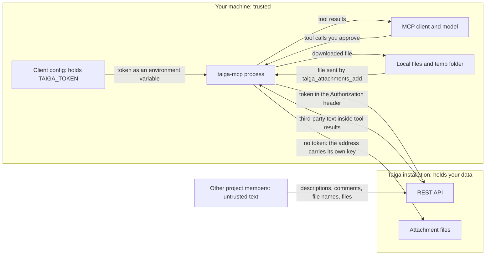
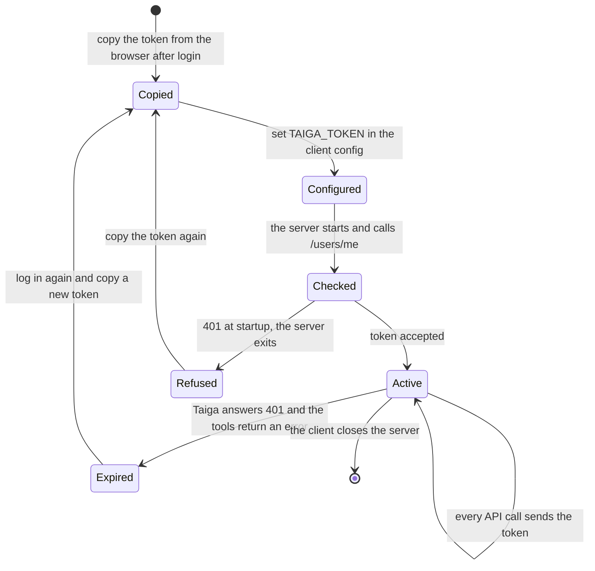

# Security

`taiga-mcp` is a local MCP server: your MCP client starts it as a process of your user account, and it holds a
token that is your session in Taiga. This page says what it can touch, what can go wrong and how to report a flaw.

## Reporting a vulnerability

Report it privately, through **Report a vulnerability** in the Security tab of the
[repository](https://github.com/CamposCodes/taiga-r2da-mcp/security/advisories/new). Do not open a public issue
for a vulnerability and never paste a token, even an expired one, in an issue or a pull request.

Say which version you ran, what you did and what happened. Fixes are made on the latest version only.

## What the server can touch

The MCP documentation is direct about local servers: a local server "is not a plugin running inside a sandbox
the protocol provides. It is an ordinary operating system process"
([Local Server Security](https://modelcontextprotocol.io/docs/2026-07-28/tutorials/security/local-server-security.md)).
This is what this one does with that access:

| Access | What the code does |
| --- | --- |
| Environment | Reads `TAIGA_URL`, `TAIGA_TOKEN`, `TAIGA_WRITE` and `TAIGA_DELETE`, and asks Node where the temp folder and the home folder of the user are. Nothing else |
| Network | Calls `<TAIGA_URL>/api/v1` with the token, and the addresses that API lists for attachments without it, as long as they are `http` or `https`. Nowhere else. Every request has a time limit of 120 seconds and a size limit: 32 MB for an answer of the API, 25 MB for a file, counted as the bytes arrive |
| Files, reading | Only the file at the path given to `taiga_attachments_add`, after following links, and only when the server runs with `TAIGA_WRITE=1`. A path that looks like a credential is refused before the file is read |
| Files, writing | Only inside the temp folder of the system: one folder for each run of the server, `taiga-mcp-` and six random characters, made when the first attachment is saved. An attachment is saved when it is neither a text nor an image of up to 3.5 MB |
| Other processes | Starts none. Runs no shell command |
| Taiga | Reads what the user of the token can read. With `TAIGA_WRITE=1`, creates and edits user stories, tasks and issues and attaches files to them. With `TAIGA_DELETE=1` on top of that, deletes user stories, tasks and issues. Without `TAIGA_DELETE=1` it deletes nothing |

## Trust boundaries

The diagram shows where the token travels, where text written by other people enters, and where local files
cross.

The same diagram in Mermaid, with every label

Three things cross a boundary:

1. **The token.** It goes from the configuration of your client to the server as an environment variable, and
   from the server to the Taiga API in the `Authorization` header. It is never sent to an attachment address,
   never written to disk by the server and never part of a tool result or a log line. A token with a space or a
   line break in it is refused at start, without being shown. The server refuses to start
   when `TAIGA_URL` is a plain `http://` address, over which the token would travel in clear text, unless the
   address is this machine (`localhost`, `127.0.0.1`, `[::1]`).
2. **Text written by other people.** Descriptions, comments, file names and file contents are written by anyone
   with access to the project. They reach the model inside tool results exactly as written, and they can contain
   instructions aimed at the model.
3. **Local files.** A file leaves your machine only through `taiga_attachments_add`, which refuses a path that
   looks like a credential. A file enters it only through `taiga_attachments_get`, into the one folder that run of
   the server made inside the temp folder, under a name the server builds.

## Threats and what answers them

| Threat | What the server does | What is left to you |
| --- | --- | --- |
| Someone reads the token from the client configuration | Nothing: the file belongs to the client. The Claude Desktop extension asks for the token in a form, and how it is stored is up to Claude Desktop: see [Install as an extension](clients/claude-desktop.md#install-as-an-extension) | Keep the configuration out of repositories and shared folders. A token typed in a `claude mcp add` or `codex mcp add` command also stays in the history of the shell. Treat a copied token as valid until it expires, even after logging out in the browser |
| The token is the whole session, not a narrow permission | Sends it only to `TAIGA_URL`. Registers no write tool without `TAIGA_WRITE=1`, and no delete tool without `TAIGA_DELETE=1` on top of it | Use an account with the role the work needs. Ask who runs your Taiga before connecting an AI client to it |
| A comment or a file tells the model to do something (prompt injection) | Tells the model, in its instructions and in the descriptions of `taiga_items_get` and `taiga_attachments_get`, that what comes from Taiga is written by other people and is data, not instructions. Keeps line breaks out of the question it puts before a deletion and out of every line of the trail, so a subject cannot forge a second question or a second line. Declares which tools write, and which of them replace or delete what was there, so the client can ask before each one. Never follows text by itself: it has no model inside | With writing on, read what the model proposes before allowing it. Do not set the write tools or the delete tool to "always allow" |
| A task tells the model to attach one of your files | `taiga_attachments_add` exists only with `TAIGA_WRITE=1` and sends only a regular file of up to 25 MB, to a user story, a task or an issue. After following links, it refuses a path that looks like a credential: a folder or a file whose name starts with a dot anywhere in the path (`.ssh`, `.env`, `.aws`, `.git`), the folder where programs keep the data of the user (`AppData` on Windows, `Library` on macOS) except the temp folder inside it, a key file (`.pem`, `.key`, `.p12`, `.pfx`, `.ppk`, `.kdbx`), a network path (`\\host\share`, refused before the disk is touched, because `\\localhost\C$` is another name for those same folders and another host would be offered your credentials) and, on Linux, the files the system makes up under `/proc`, `/sys`, `/dev` and `/run` (`/proc/self/environ` is the environment of the server, token included) | Check the path in the permission prompt. The refusal is a deny list, not a sandbox: a secret kept under an ordinary name in an ordinary folder, or copied to one, is not recognised. Any other file your user can read can still be sent |
| The model creates or edits the wrong thing | Creates and edits only user stories, tasks and issues. An edit sends only the fields given, and the three tools that edit are marked as destructive (`destructiveHint: true`), because a description or the tags are replaced whole. An edit that gives a description or the tags must also give the `version` that `taiga_items_get` answered for the item: without it, or when the item is at another version by then, nothing is changed, so an edit somebody made in the meantime is not overwritten without a word. A move, an assignee, a due date, a block or a comment needs no version. Without `TAIGA_DELETE=1` nothing is deleted. What it writes goes out in your name and notifies the team as usual | Turn writing on only where you follow what the model does. The version is a guard against a lost edit, not a confirmation: the refusal names the current version, so the model can send the edit again without your seeing what changed |
| The model deletes the wrong thing | `taiga_items_delete` exists only with `TAIGA_DELETE=1` on top of `TAIGA_WRITE=1`; `TAIGA_DELETE=1` alone stops the server at start. A deletion takes two calls: the first deletes nothing, shows the item (for a user story, also the tasks that go with it) and gives a random code, and only a second call with that code can delete. The server keeps the code with what it stands for: that item of that project, as it was shown. It is good once, for ten minutes and only for the last item shown; a guess, a code of another item or project, a used one, or the code of an item that changed since (a new task in the user story counts) deletes nothing. On that second call, when the client has declared that it can put a question from a server to its user (the `elicitation` capability of MCP), the server asks you through the client, naming the item and the tasks that go with it, and only your yes deletes: a no, a cancel or an answer without the yes deletes nothing, spends the code and leaves a line on stderr. The tool is marked as destructive, and the model is told to ask you before the second call | The model cannot answer the question of the server: the client carries it to you, so read what it names before you say yes. In a client that did not declare the capability the server asks nobody: the second call is made by the model, not by you, and the code proves that the item was shown, not that a person said yes. There the person in the loop is the permission prompt of your client, so do not set this tool to "always allow". Which clients declare the capability was not checked. Taiga keeps no trash, and deleting a user story deletes its tasks: leave `TAIGA_DELETE` off unless you need it |
| Your role lacks a permission and the model reaches the goal another way | Before a write, checks the permissions Taiga lists for your role in the project (`myPermissions` in `taiga_projects_get`). When the one needed is missing it sends nothing, and the error says what the role may do instead and tells the model not to pick one on its own: report, offer, wait. A `403` from Taiga carries the same request, and the instructions of the server repeat it | This is an instruction to the model, not a barrier: each alternative is a tool your role may use, so the server does not block it. The permissions themselves are enforced by Taiga. A project that gives no list is not checked by the server: the write is sent and Taiga decides |
| Somebody takes the place of a colleague by choosing that colleague's username as full name | Looks a person up by id, then by username, and only then by full name. A full name that two members share is refused, with their usernames | Give usernames when names repeat in a project |
| Nobody can tell afterwards what the model changed or tried | Writes one line to stderr for every change sent to Taiga (method, path and the status Taiga answered), for every tool error (its message), for every file sent as an attachment (its name and size) and for every attachment saved to the disk (where it went), with the time. Never the token, and never the content of an item: what a line can carry of other people's text is a name (of an attachment, a status or a member) inside the message of a tool error, kept on one line. A deletion leaves its line there, which is the last record of an item Taiga no longer has, and so does a deletion you did not approve when the server asked | The trail is as lasting as the log your client keeps of the server: check where your client stores it and for how long. Edits are also in the history of each item in Taiga, in your name |
| A model stuck in a loop floods Taiga | At most 120 tool calls a minute; the next call is refused with the time to wait | – |
| Taiga stops answering and a tool waits for ever, or answers with more than the server can hold | Every request to Taiga, and every download of an attachment, has a time limit of 120 seconds and a size limit: 32 MB for an answer of the API and 25 MB for a file, counted as the bytes arrive, whatever size Taiga declared. After either the tool answers with an error | – |
| A file name from Taiga tries to leave the temp folder | Builds the saved name itself and keeps only letters, digits, dot, dash and underscore | – |
| Another user of the same machine reads the saved files, or prepares the folder they go to | Saves the files of a run in one folder made by `mkdtemp` on the first file saved: a name with six random characters and, on Linux and macOS, a mode that lets only your user in. If the folder is deleted meanwhile, the next file gets a new one | – |
| A tool that is trusted as read-only writes to your disk | Does not mark `taiga_attachments_get` as read-only (`readOnlyHint: false`, `destructiveHint: false`, `idempotentHint: true`): it changes nothing in Taiga, but it can save a file to the temp folder. The other 9 read tools are marked read-only and send only `GET` requests | A client that asks before every tool not marked read-only now asks before opening an attachment. If you allow this tool without a prompt, files written by other people are saved to the temp folder without your seeing each one. The server saves them and never opens or runs them |
| Downloaded files pile up | Nothing: they stay until deleted | Delete the `taiga-mcp-` folders of the temp folder after use |
| `TAIGA_URL` points to the wrong place | Refuses to start when the address is not `https://`, unless it is this machine (`localhost`, `127.0.0.1`, `[::1]`). Refuses an address that carries a user or a password too: the address is printed in the status line and in error messages, and the token goes in `TAIGA_TOKEN`. Beyond that it trusts the address you give, and the attachment addresses that address returns, as long as they are `http` or `https` | Set `TAIGA_URL` to an address you know. A wrong `https://` address still receives the token |
| A dependency is compromised | Two direct runtime dependencies, `@modelcontextprotocol/server` and `zod`. With `@modelcontextprotocol/core`, which the first one brings, three packages are installed to run the server, and none of the three versions is left open: `package.json` names the two direct ones at exact versions, and the first one names the third at an exact version, so the package from npm brings the versions the scenarios run with. `package-lock.json` pins the three with their hashes for a build from source; those hashes do not travel with the package on npm. The Claude Desktop extension carries the built server and those same three packages. The tool that packs it, `@anthropic-ai/mcpb` 2.1.2, is not a dependency of the project, because its own dependencies carry open security advisories: it is fetched with `npx` when the extension is built and runs on the machine of whoever builds the file, not in the server | The commands of these documents end in `@latest`, the newest version published, as the READMEs of other MCP servers do: with it, a new version of this server runs without a review of yours. To decide yourself when to move, name the version you run, `@campos-codes/taiga-r2da-mcp@0.3.0`. The package on npm was published from the machine of the maintainer, with no provenance attestation, so what ties it to this repository is the word of the maintainer: to remove that doubt, build from a commit you chose, with `npm ci`. Install an extension only when you know who built the file |

What the server does **not** do: it does not confirm a create or an edit with you by itself, and it confirms a
deletion with you only through a client that can carry its question (in a client that cannot, no confirmation
comes from the server). It does not filter or rewrite the text it reads from Taiga, does not sandbox itself, does
not limit `taiga_attachments_add` to one folder and does not renew or revoke the token.

## The token

The diagram shows the life of a token, from the copy in the browser to its expiry.

The same diagram in Mermaid, with every label

- The token is the one Taiga 6 gives the browser after login: the value of the key `token` in the Local Storage
  of the Taiga site. Copy only `token`, not `refresh`.
- How long it lasts is set by whoever runs your Taiga. Where this server was developed it lasted about a day.
- The server does not renew it. In Taiga 6 a renewal replaces the refresh token on every use `[not verified]`,
  which would end the browser session the token was copied from.
- At start the server checks the token with `GET /users/me` and exits if it is refused. Later, a `401` from Taiga
  becomes a tool error that says how to get a new token; the server keeps running with the old one until you
  change the configuration and restart it.

### A token made for this server

Today the token is the one copied from the browser. The owner of this project plans a screen in Taiga that hands
out a token for this server. The server needs no change for a screen that issues a token the Taiga API accepts in
`Authorization: Bearer`: any such token already works in `TAIGA_TOKEN`. What such a screen has to meet:

| What has to hold | What the server does with it |
| --- | --- |
| The Taiga REST API accepts the token in the header `Authorization: Bearer <token>` | Sends every request to the API with that header, and with no other credential |
| A token that expired or was revoked is answered with HTTP 401 | Stops at start, or answers the tool call with an error that tells the user to get a new token. The message names the Local Storage of the browser, the only source there is today |
| A token that may only read, or a role without a permission, is answered with HTTP 403 on a write. Better, it is also reflected in the `my_permissions` list of each project | Reports a 403 as a refusal, says that nothing was changed and points to what the user may do (`myPermissions` of `taiga_projects_get`). Checks the list before it sends a write: when the permission is missing nothing is sent, and the error says what can be done instead |
| `GET /users/me` answers with the user of the token | Calls it at start, and names that user in its status line |

A screen that hands out Taiga's own application tokens is not supported today: those go in
`Authorization: Application <token>`, and the server sends only `Bearer`. Supporting them would need one change
in the server.

## Running it more safely

These come from the MCP guide for local servers, read on 2026-10-11:
<https://modelcontextprotocol.io/docs/2026-07-28/tutorials/security/local-server-security.md>.

- **Know what you run.** "only install servers whose source code you can read and whose publisher you can
  identify, and pin the exact version." Build from a commit you chose.
- **Pass secrets per server.** "Use the per-server environment configuration in your client's config file rather
  than exporting secrets in your shell profile, so each server sees only its own credentials." The three client
  guides in [`docs/clients/`](clients/) do it this way.
- **Know where it talks.** "A server that wraps one API has a short, predictable set of destinations." For this
  server: the host of `TAIGA_URL`, and the host of your attachment files if it is a different one.
- **Isolate it if you want a hard boundary.** "run third-party servers inside a container (for example with
  Docker or Podman) with no volume mounts beyond what the server needs." Without writing on, this server needs no mount at all, apart from a place
  for the temp folder if you want to open saved attachments.
- **Why it runs locally at all.** The same guide says a server that only wraps a remote API gains nothing from
  running on your machine. This one runs locally for two reasons: it uses the session token of each person, which
  a shared server would have to collect, and it reads and writes attachments on the disk of that person.
