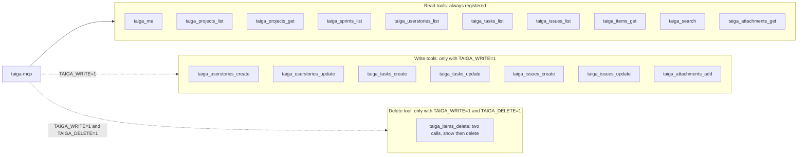
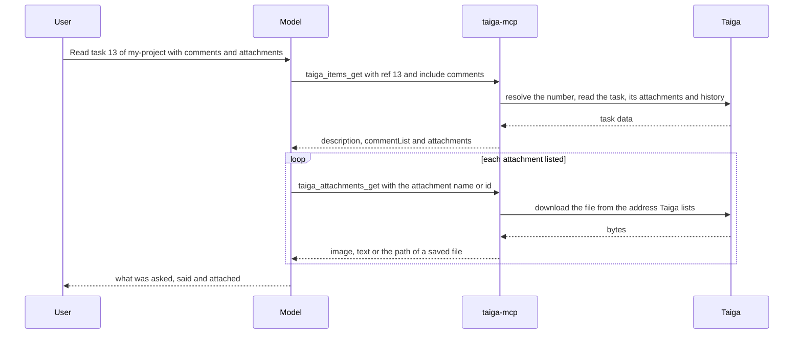
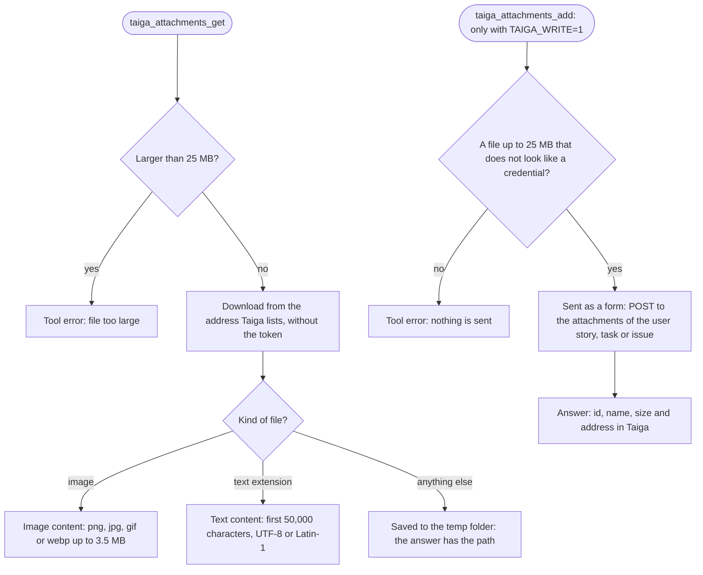

# Usage

What to ask for and what the model does with the tools. You never have to name a tool: ask in plain language, in
the language your team uses in Taiga.

## The tools at a glance

The diagram shows the 18 tools in their three groups: the 10 that are always there, the 7 that exist only with
`TAIGA_WRITE=1`, and the 1 that deletes, which exists only with `TAIGA_DELETE=1` on top of `TAIGA_WRITE=1`.



<details>
<summary>The same diagram in Mermaid, with every label</summary>



</details>

| Group | Tools | What they are for |
| --- | --- | --- |
| Who and where | `taiga_me`, `taiga_projects_list`, `taiga_projects_get` | The user of the token, their projects, and the names each project accepts |
| Boards | `taiga_sprints_list`, `taiga_userstories_list`, `taiga_tasks_list`, `taiga_issues_list` | Lists with filters, one summary line per item |
| One item | `taiga_items_get`, `taiga_attachments_get`, `taiga_search` | Everything about an item, the content of its files, and search by words |
| Writing | `taiga_userstories_create`, `taiga_userstories_update`, `taiga_tasks_create`, `taiga_tasks_update`, `taiga_issues_create`, `taiga_issues_update`, `taiga_attachments_add` | Create, edit and move a user story, a task or an issue, and attach a file to one |
| Deleting | `taiga_items_delete` | Delete a user story, a task or an issue, in two calls |

Parameters, example answers and errors of each tool are in [docs/tools.md](tools.md).

## Workflows

### Find your way around

1. `taiga_projects_list` gives the slug of each project.
2. `taiga_projects_get` gives the names that project accepts: statuses of user stories, tasks and issues,
   members, sprints, issue types, severities and priorities. It also gives what your role may do in the project
   (`myPermissions`).

The model does both by itself when you name a project. Names are matched without regard to case, and a wrong
name is answered with the valid ones.

### Answer a question about a board

The list tools take the same filters: `status`, `assignee` (or `"none"` for unassigned), `closed`, `sprint` (or
`"backlog"` for no sprint), `tag` and `text`. Every answer has `total`; when it is larger than `page * size` there
is another page.

Example requests:

- "Which projects do I have in Taiga?"
- "List the open tasks of the current sprint of my-project, grouped by person."
- "Which tasks of my-project have nobody assigned?"
- "How many user stories did Sprint 12 close and how many are still open?"
- "Search my-project for 'PDF'."

### Understand a whole task

The diagram shows the calls behind "read this task with everything in it": one call for the task and its
comments, then one call per attachment.



<details>
<summary>The same diagram in Mermaid, with every label</summary>



</details>

- `taiga_items_get` finds the item by its number, whatever its kind. A user story comes with the list of its
  tasks.
- Comments and history are loaded only when asked for, with `include`.
- An image pasted into a description or a comment is an attachment too, and appears in the list.

Example requests:

- "Summarize task #13 of my-project with its comments."
- "Read task #13 whole, with comments and attachments, and tell me what is left to do."

### Attachments

The diagram shows what happens to an attachment when it is read, according to its kind, and what happens when a
file is sent.



<details>
<summary>The same diagram in Mermaid, with every label</summary>



</details>

- An image of up to 3.5 MB reaches the model as an image. A text file reaches it as text, up to 50,000
  characters.
- Anything else is saved to the folder of that run of the server, and the answer is the path. The server makes
  the folder (`taiga-mcp-` and six random characters, inside the temp folder of the system) on the first file it
  saves and uses it until it stops. The files stay there until someone deletes them. The model then reads the
  file with the file tool of the client, if the client has one that reads that kind of file.
- A file above 25 MB is neither opened nor sent.
- Files are read from user stories, tasks and issues, and sent to any of the three.
- `taiga_attachments_add` refuses a file that looks like a credential: a folder or a file whose name starts with
  a dot anywhere in the path (`.ssh`, `.env`), the folder where programs keep the data of the user (`AppData` on
  Windows, `Library` on macOS) except the temp folder inside it, and key files such as `.pem` and `.key`. The
  full list is in [docs/tools.md](tools.md). It is a deny list, not a sandbox: any other file you can read can be sent.
- `taiga_attachments_get` is the one read tool that is not marked read-only, because it can save a file. A client
  that asks before every tool not marked read-only asks before opening an attachment.

### Write, with `TAIGA_WRITE=1`

Start the server with `TAIGA_WRITE=1` to get the seven write tools. How to set it is in the guide of your client:
[Claude Code](clients/claude-code.md), [Claude Desktop](clients/claude-desktop.md), [Codex](clients/codex.md).

- A new user story without `status` gets the default status of the project; without `sprint` it is in no sprint.
- A task needs a user story or a sprint. A task in a user story is always in the sprint of that story.
- **Moving a task on the board** is giving its new `status`. **Moving it to another user story** is giving
  `userStory`.
- `assignee: "none"` removes the assignee, `dueDate: "none"` removes the due date, `blocked: "<reason>"` blocks
  and `blocked: "none"` unblocks.
- `description` and `tags` replace what was there, so an edit of either needs the `version` of the item: the
  model reads the item first with `taiga_items_get`, which answers `version`, and sends the complete new text or
  list with it. See [Edit a description or the tags](#edit-a-description-or-the-tags).
- Descriptions, comments and block reasons are Markdown.
- The answer has the item as Taiga left it and its address, to check on the screen. The answer of an edit also
  has `version`, the one the write left.
- Each kind of item has its own tool to edit it. When the model picks the wrong one, the error says what the
  number is, for example `#12 is not a task: it is a user story.`, and the model calls the right tool.
- Attaching is giving the item and the full path of a file on the machine where the server runs. To show an
  image inside a description or a comment, the model writes `` with the address from the answer.

Example requests:

- "Create the user story 'Export report as PDF' in my-project and, inside it, one task for the back end and one
  for the screen."
- "In user story #12 of my-project, create the task 'Validate the tax id on sign-up', for me, due on the 20th."
- "Move task #13 to 'In progress' and comment that I started today."
- "Block #13: waiting for the customer."
- "Attach /home/ana/error-login.png to task #13 and show the image in the description."

What cannot be done through this server: editing sprints or wiki pages, setting the points of a user story,
anything with epics, and deleting an attachment, including one sent by mistake. Deleting a user story, a task or
an issue needs `TAIGA_DELETE=1` as well: see [Delete an item](#delete-an-item-with-taiga_delete1).

The sections below show, for each request, the call it leads to. Their arguments use the project of the tests,
whose statuses have Portuguese names (`A fazer`, `Concluído`, `Fechado`): names are whatever your team typed in
Taiga.

### Edit and move a user story

`taiga_userstories_update` changes a user story that already exists. Only the fields given are changed.

- **Moving it on the kanban** is giving its new `status`.
- **Moving it to another sprint** is giving `sprint`. `sprint: "backlog"` takes it out of every sprint.
- A `comment` can go alone or with the changes.

| Request | Arguments of `taiga_userstories_update` |
| --- | --- |
| "Move user story #12 of my-project to 'Concluído', take it out of the sprint, leave only the tag 'pronto' and comment 'entregue'." | `{ "project": "my-project", "ref": 12, "status": "Concluído", "sprint": "backlog", "tags": ["pronto"], "comment": "entregue", "version": 4 }` |
| "Rename user story #12 to 'Export report as PDF', give it to ana and set it due on 2026-10-20." | `{ "project": "my-project", "ref": 12, "subject": "Export report as PDF", "assignee": "ana", "dueDate": "2026-10-20" }` |
| "Block user story #12: waiting for the customer." | `{ "project": "my-project", "ref": 12, "blocked": "waiting for the customer" }` |
| "Comment on user story #12 that the report is ready for review." | `{ "project": "my-project", "ref": 12, "comment": "The report is ready for review." }` |

The first request replaces the tags, so the call gives `version`: the model read the user story with
`taiga_items_get`, which answered `"version": 4`. The server reads the user story again, finds it still at
version 4 and sends `PATCH /userstories/100` with
`{ "version": 4, "status": 2, "milestone": null, "tags": ["pronto"], "comment": "entregue" }`: names became ids,
and what was not asked is not sent. The answer is the user story as Taiga left it, with `"version": 5` and its
address, `https://taiga.example.com/project/my-project/us/12`. The other three requests replace neither a
description nor the tags, so they need no `version`.

### Edit a description or the tags

`description` and `tags` are replaced whole, so the three tools that edit ask for the `version` of the item when
a call gives either of them. `taiga_items_get` answers it. Example request: "Rewrite the description of task #13
of my-project as 'novo texto' and leave only the tag 'novo'." The model reads the task, which is at version 7,
and calls `taiga_tasks_update`:

```json
{ "project": "my-project", "ref": 13, "description": "novo texto", "tags": ["novo"], "version": 7 }
```

The server reads the task again, finds it still at version 7 and sends `PATCH /tasks/200` with
`{ "version": 7, "description": "novo texto", "tags": ["novo"] }`. The answer has `"version": 8`, the one this
write left, for the next edit.

- Without `version` nothing is changed, and the error tells the model to read the item first:
  `A description or the tags replace what #13 has now: read it with taiga_items_get and give its version, so that a change somebody made in the meantime is not lost.`
- With a version that is not the current one, because somebody changed the task after it was read, nothing is
  changed either:
  `#13 changed since version 6: it is at version 7 now. Read it again with taiga_items_get, look at what changed and send the edit with the new version.`
- A move, an assignee, a due date, a block or a comment loses nothing, so it needs no `version`.
- To add to a description, the model sends the complete text: what it read plus what is new.

### Create and move an issue

`taiga_issues_create` registers a bug, a question or an improvement. `taiga_issues_update` changes one.

- Type, severity and priority are given by name, as `taiga_projects_get` lists them. A new issue without them,
  or without `status`, gets the default ones of the project.
- **Moving an issue** is giving its new `status`, or the `sprint` it goes to. `sprint: "backlog"` takes it out of
  every sprint.

| Request | Tool | Arguments |
| --- | --- | --- |
| "Register a bug in my-project, 'Falha': it does not open. Severity 'Normal', priority 'Alta', for ana." | `taiga_issues_create` | `{ "project": "my-project", "subject": "Falha", "description": "não abre", "issueType": "Bug", "severity": "normal", "priority": "Alta", "assignee": "ana" }` |
| "Close issue #14, put it in Sprint 12 and unblock it." | `taiga_issues_update` | `{ "project": "my-project", "ref": 14, "status": "fechado", "sprint": "Sprint 12", "blocked": "none" }` |
| "Take issue #14 out of the sprint." | `taiga_issues_update` | `{ "project": "my-project", "ref": 14, "sprint": "backlog" }` |

The first call answers with the new issue: its number, `"ref": 17`, and its address,
`https://taiga.example.com/project/my-project/issue/17`. For the second, the server sends `PATCH /issues/300`
with `{ "version": 2, "status": 22, "milestone": 3, "is_blocked": false, "blocked_note": "" }`.

### Delete an item, with `TAIGA_DELETE=1`

Start the server with `TAIGA_DELETE=1` next to `TAIGA_WRITE=1` to get `taiga_items_delete`. Alone,
`TAIGA_DELETE=1` stops the server at start. Taiga keeps no trash: what is deleted is gone, with its comments and
attachments, and a user story takes its tasks with it.

A deletion takes two calls, with a question to you between them and, where your client can carry it, a second
question from the server itself:

1. The model calls `taiga_items_delete` without `confirm`. Nothing is deleted. The answer shows the item, the
   tasks that would go with a user story, and a code.
2. The model shows you that and asks whether it is really to be deleted.
3. Only after your yes, the model calls again with the code in `confirm`.
4. When your client has declared that it can put a question from a server to its user, the server now asks you
   through the client, and only your yes there deletes the item. In a client that did not declare it, the item
   is deleted on the call of step 3.

Example request: "Delete user story #12 of my-project." The first call:

```json
{ "project": "my-project", "ref": 12 }
```

```json
{
  "deleted": false,
  "item": {
    "type": "us",
    "ref": 12,
    "subject": "História",
    "status": "A fazer",
    "closed": false,
    "sprint": "Sprint 12",
    "assignees": ["ana"],
    "points": 5,
    "tags": ["api"],
    "dueDate": null,
    "blocked": false,
    "comments": 2,
    "createdAt": "2026-10-01T12:00:00Z",
    "modifiedAt": "2026-10-09T15:30:00Z",
    "finishedAt": null
  },
  "tasksDeletedWithIt": ["#13 Tarefa"],
  "confirm": "0d9c6f3a-52b7-4e1c-9a4f-7b1e2c8d5a60",
  "next": "Nothing was deleted. Show this to the user and ask whether it is really to be deleted. Only after a yes, call again with this code in confirm."
}
```

The model then asks you something like: "User story #12 'História' and its task #13 'Tarefa' would be deleted
for good. Delete them?" After your yes, the second call:

```json
{ "project": "my-project", "ref": 12, "confirm": "0d9c6f3a-52b7-4e1c-9a4f-7b1e2c8d5a60" }
```

Where the client can carry it, the server then asks you, with one yes/no field:

```text
Delete the user story #12 "História" of my-project, with its tasks #13? Taiga keeps no trash: this cannot be undone.
```

With your yes, or at once in a client that cannot be asked, the call answers with `"deleted": true`, the same
`item` and the same `tasksDeletedWithIt`. With a no, a cancel or an answer without the yes, nothing is deleted
and the code is spent. The call then answers with `"deleted": false`, the same `item` and
`tasksDeletedWithIt`, and this in `next`:

```text
The user did not approve the deletion: nothing was deleted. Do not ask again unless the user brings it up.
```

- The code is random, and the one above is only an example. It is good once, for ten minutes, and only for the
  last item shown, as it was shown. If someone changed the item in the meantime, or added a task to the user
  story, nothing is deleted: the item is shown again as it is now, with a new code, and the model asks you again.
- Up to three parts can ask you. The model asks in the conversation, between the two calls. Your client may
  ask for permission before each call: the tool is marked as destructive. And the server asks through the client
  on the second call, when the client has declared that it can put a question from a server to its user. The
  model cannot answer that last question: it is the client that carries it to you.
- In a client that did not declare it, the second call is made by the model, not by you, so what keeps a person
  in the loop is the permission prompt of the client. Read [docs/security.md](security.md) before allowing this
  tool without a prompt.
- When your role may not delete the item, the first call already says so, with what the role may do instead, for
  example close the item by moving it to a closed status or leave a comment asking for the deletion.
- With `TAIGA_WRITE=1` alone the tool does not exist, and the instructions of the server tell the model that
  nothing can be deleted.
- An attachment cannot be deleted through this server, only the item it belongs to.

### When your role lacks a permission

Before a write, the server looks at what Taiga says your role may do in the project. When the permission is
missing nothing is sent, and the error lists what the role may do instead. The model is told not to choose for
you: it tells you what was refused, offers the alternatives and waits.

Example request: "Create the user story 'História nova' in locked-project." In the project of the tests the role
may create tasks and comment on user stories, and may not create a user story or an issue. The call:

```json
{ "project": "locked-project", "subject": "História nova" }
```

`taiga_userstories_create` answers with this error:

```text
You do not have permission to create a user story in locked-project: your role lacks the Taiga permission add_us. Nothing was done. What your role allows here instead: (1) create only a task, in a user story that already exists or in a sprint with no user story (taiga_tasks_create); (2) write it as a comment on a user story that already exists (taiga_userstories_update with only comment); (3) ask a project admin to do it, or to give your role this permission. Do not work around this on your own: tell the user what was refused, offer the alternatives and wait for the choice.
```

The model reports the refusal and offers the three ways out. What happens next is your choice:

| Your answer | Tool | Arguments |
| --- | --- | --- |
| "Then create it as a task in user story #12." | `taiga_tasks_create` | `{ "project": "locked-project", "subject": "Só a tarefa", "userStory": 12 }` |
| "Leave it as a comment on user story #12." | `taiga_userstories_update` | `{ "project": "locked-project", "ref": 12, "comment": "História nova" }` |
| "I will ask an admin." | none | – |

The first one answers with the new task: `"ref": 15`, `"userStory": "#12 História"` and the address
`https://taiga.example.com/project/locked-project/task/15`. In a project that has sprints, the same alternative
can be a task with no user story, in the row of a sprint: `taiga_tasks_create` with `sprint` in place of
`userStory`, as in `{ "project": "my-project", "subject": "Sem história", "sprint": "Sprint 12" }`.

- Only what the role may do is offered. In this example an issue is not, because the role lacks `add_issue`.
- The alternatives for each refusal are in the [Permissions](tools.md#permissions) section of docs/tools.md.
- An edit that is only a comment needs only the permission to comment. In the same project,
  `{ "project": "locked-project", "ref": 13, "comment": "alguém pode mover?" }` goes through
  `taiga_tasks_update`, although the role may not edit tasks.
- `taiga_projects_get` shows the permissions of your role in `myPermissions`.
- When the refusal comes from Taiga itself, the error says that Taiga refused the request because the current
  user does not have the permission for it, and asks the same of the model.

## Limits to know

- **Assignee filter on user stories.** It finds only the main assignee of a user story.
- **Position inside a column.** Moving changes the column (the status); the order inside the column is Taiga's.
- **Sprints.** `taiga_sprints_list` asks Taiga for up to 200 sprints.
- **Long histories.** `taiga_items_get` with `include` loads up to 1,000 history entries in one answer.
- **Call rate.** The server runs at most 120 tools a minute and answers the next call with the time to wait.
- **Time limit.** A request to Taiga that takes more than 120 seconds is stopped, and the tool answers with an
  error.
- **No undo.** The server has no tool that undoes an edit, and a deletion is for good: Taiga keeps no trash.
- **Not covered.** Content of wiki pages, epics, timelines, notifications, statistics and custom fields.

## Troubleshooting

| Symptom | Likely cause | What to do |
| --- | --- | --- |
| `Taiga refused the token: it expired or is wrong.` | The token expired, is incomplete, or another key was copied. No tool works until it is replaced, and the error tells the model to say so | Copy the `token` key again, set `TAIGA_TOKEN` again in the configuration of the server and have the client start the server again |
| `Missing environment variable TAIGA_URL` (or `TAIGA_TOKEN`) | The client configuration lacks the variable | Add it to the configuration of the server in your client |
| `TAIGA_URL must start with https://: ...` | The address is a plain `http://` one, over which the token would travel in clear text | Use the `https://` address. Only this machine (`localhost`, `127.0.0.1`) may be reached over `http://` |
| `TAIGA_URL must not carry a user or a password: ...` | The address has `user:password@` in it | Remove it: the token goes in `TAIGA_TOKEN` |
| `TAIGA_DELETE=1 needs TAIGA_WRITE=1: ...` | Deleting was turned on without writing | Set both variables, or neither |
| `Taiga API unreachable at ...: fetch failed: ...` | No network, a VPN that is off, Taiga down, a wrong address, or a network that replaces TLS certificates. A read was already tried twice; a write was sent once, and the error says to read the item before sending it again. The error tells the model to say that the server cannot reach Taiga | Open the address in the browser. When it opens, ask again; if it still fails, start the server again in the client. On a network with TLS inspection, point `NODE_EXTRA_CA_CERTS` to the `.pem` file of its authority |
| `Taiga API unreachable at ...: The operation was aborted due to timeout` | Taiga took more than 120 seconds to answer | Ask again. If it repeats, check the network and your Taiga |
| `Unknown ... status "X". Valid: ...` | A name that does not exist in that project | Use one of the names in the message |
| `"X" is not a member of this project` | A person outside the project, or another spelling | The message lists the valid usernames |
| The model says it cannot create or edit | The server was started without `TAIGA_WRITE=1` | Add the variable and restart the server |
| The model says it cannot delete | The server was started without `TAIGA_DELETE=1` | Add it next to `TAIGA_WRITE=1` and restart the server |
| `You do not have permission to ...: your role lacks the Taiga permission ...`, or `Taiga refused ...: the current user does not have the permission for it.` | Your role cannot do that in that project | Choose one of the alternatives the message lists, or ask a project admin. `taiga_projects_get` shows `myPermissions` |
| `#12 is not a task: it is a user story.` | The tool that was called is for another kind of item | Nothing: the model calls the tool of the right kind |
| `A task needs a user story or a sprint` | A task was asked for with neither | Say which user story or sprint it goes to |
| `A description or the tags replace what #13 has now: ...` | The model sent a new description or new tags without the version of the item | Nothing: the model reads the item with `taiga_items_get` and sends the edit again with its `version` |
| `#13 changed since version 6: it is at version 7 now. ...` | Somebody changed the item after the model read it | The model reads the item again. Check that the new text keeps what the other person changed |
| A version error from Taiga on an edit | Someone changed the item at the same moment | Ask again: the server reads the item again on every edit |
| `"deleted": false` with `The user did not approve the deletion: ...` | You answered no to the question before a deletion, or closed it | Nothing was deleted. Ask for the deletion again if you want it |
| `... is not sent: it looks like a credential or a configuration file ...` | The path is on the deny list of `taiga_attachments_add` | If the file really is to be sent, copy it to another place under another name, as the message says |
| `403` or `404 ... on the file of the attachment` | The address of the file expired, or files are not served without a login | Ask again. If it repeats, your Taiga serves files in a way this server does not handle: open an issue |
| `Too many calls: ...` | More than 120 tool calls in a minute | Wait the seconds the message says |

To see the server start outside a client, run `node dist/index.js` with the two variables set: it prints the
address, the user and whether it writes, or the reason it stopped.
